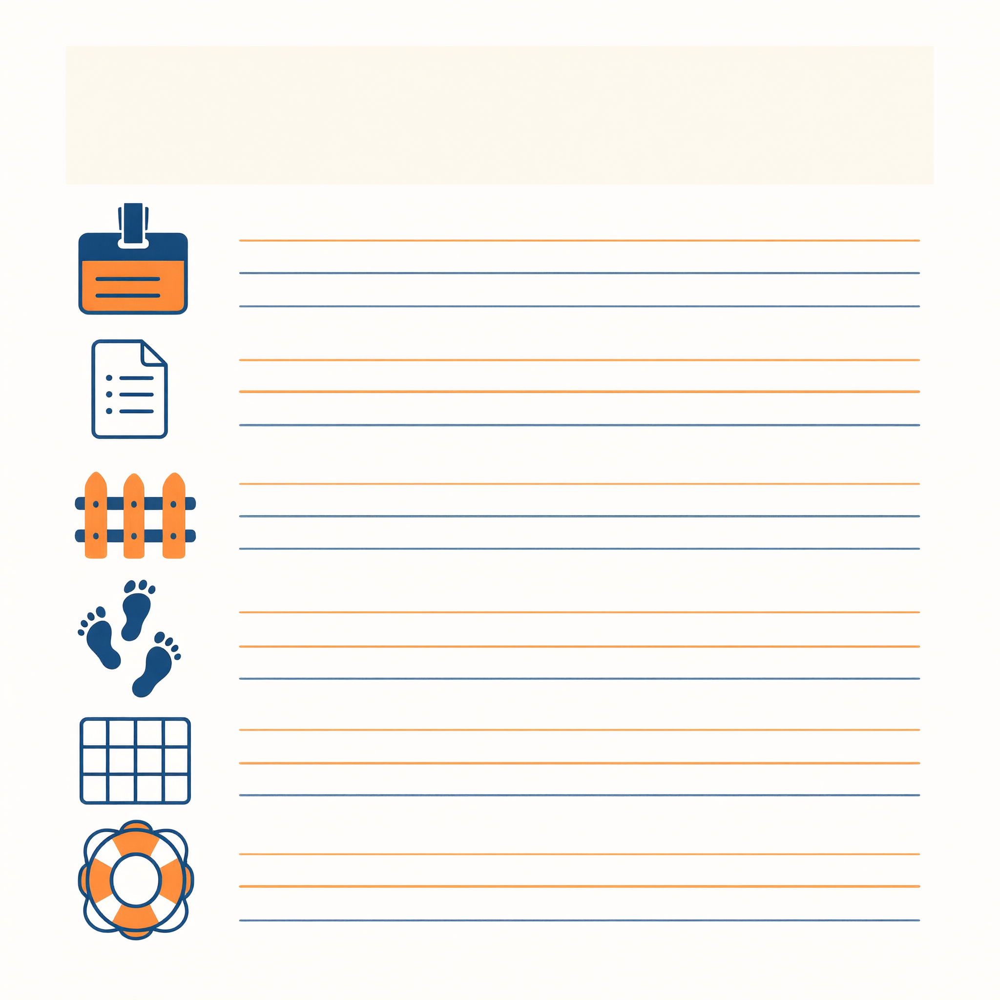

# 第 2 章　构件一 Prompt：写好员工手册

> 书稿状态：初稿 v0.1｜目标字数：约 1.1 万｜体例：动手章模板（策划案 §3.1）
> 本章图表：图 2-1 ～ 图 2-6，表 2-1（配图说明见各占位处及章末清单）

---

**【本章任务】**

这一章只干一件事：把你的"凭感觉写提示词"，升级成"有结构的员工手册"。读完并做完，你将：

1. 弄懂员工手册在系统里的位置，以及"什么该写、什么不该写"；
2. 掌握**六要素模板**：角色、任务、规矩与边界、工作流程、输出格式、不确定时的兜底；
3. 认出手册的**五种慢性病**，并会开处方；
4. 学会像做实验一样改手册：一次改一处、留修订日志、喂刁难用例；
5. 完成**实验 2**：用六要素重构"课程秘书"，做新旧两版 A/B 对比，用记录说话。

时间预算：阅读约 35 分钟，动手约 50 分钟。

---

## 章首情境　翻车现场复盘

晚上十一点半，周舟第三次打开她的《实验记录单》。

两个翻车躺在表格里。第一个：请假邮件任务，手册里明明写了"起草发给别人的文字之前，先问清发给谁、语气要多正式"，秘书却一个字没问，直接把一封又硬又长的邮件怼到了她脸上。第二个：调例会时间，课表就放在资料里，它推荐的两个时间，全撞在成员有课的当口。

她的第一反应和第 1 章里你可能的反应一样：AI 真笨。

但今晚她多做了个动作——把自己写的那份员工手册从头读了一遍。读完她有点脸红。所谓的"规矩"，一共四行，其中两行是"不许编造""不要装懂"这样的口号；至于"先问清再起草"，孤零零夹在中间，前面没有触发条件，后面没有违反后果，像一句贴在墙上的"保持安静"。

她想起导师退回来论文初稿时批的那句话："不是写的问题，是提纲的问题。"

现在她面对的是同一句评语——只不过这次被批的，是一份两百字的员工手册。这一章，我们跟周舟一起重写它。

---

## 2.1　员工手册是什么：写一次，长期生效

先给"员工手册"一个正式的介绍。

你在工作台里写下的那份设置文本——A 线里叫 `QWEN.md`，B 线里叫助理的"指令"或"说明"——它的学名是**系统提示词**（System Prompt）。不同产品给它起了不同名字：自定义指令、规则、人设、记忆文件……名字随产品变，**东西是同一个**：一份常驻材料，每一轮工作开始时，系统都自动把它放进递给大脑的"任务简报包"里，放在最靠前的位置。

◆ **术语卡**｜**系统提示词（System Prompt）**：写进工作台设置、每轮自动生效的常驻指令。本书统称"员工手册"。各产品叫法不同，本质相同。

还记得第 1 章图 1-3 那个六插袋的简报包吗？员工手册就是其中一个插袋。它和你聊天时临时下的指令，分工完全不同：

- **手册是常驻的制度**：身份、规矩、格式——那些"每次都要遵守、基本不变"的东西；
- **对话是临时的命令**：这周整理什么作业、给谁写邮件——那些"每次都变"的东西。

裸机时代（第 1 章 §1.3 的第一段），这两样全靠你在对话框里手工混着贴，贴了忘、忘了贴。员工手册这个构件的价值就一句话：**把不变的部分写一次，长期生效。**

由此推出本章第一条设计原则，也是新手最常犯的方向性错误：

> **手册只写"稳定的事"，不写"每次变的事"。**
> 你的课表、社团名单、这周的任务清单——都不该出现在手册里。它们在资料室（第 3 章）和对话里。手册塞满易变细节的后果，§2.4 的"仓库病"会专门讲。

◆ **原理速览**｜手册为什么能"写一次、长期生效"？因为它被系统固定在每轮简报包的最前部，大脑每次开工都先看它。也正因为每轮都占地方，手册有长度代价——写得越长，挤占桌面（上下文）越多。为什么"挤占桌面"会让 AI 变笨，见第 8 章 §8.4–8.5。

---

## 2.2　六要素模板：一份合格手册的骨架

重写手册不需要灵感，需要清单。六要素如下——每个要素配一句功能说明、一个好例子、一个坏例子。

> 排版与标注说明（设计师用，定稿前移除）：一页手册样式的竖版模板，六个区块自上而下：①角色（我是谁、服务谁）②任务（我负责哪几件事）③规矩与边界（必须做／绝不做）④工作流程（接到任务先做什么后做什么）⑤输出格式（交付物长什么样）⑥兜底（什么情况必须停下来问人）。每区块右侧留书写横线。整体像一页信纸，顶部印"员工手册"四字。

### 要素一：角色——它是谁，在为谁工作

**功能**：定下说话的立场、深度和口吻。
**好例子**："你是我的课程秘书。我是一名大学生，本学期在读五门课，同时在一个社团任职。"
**坏例子**："你是一个无所不能的 AI 助手。"——等于没说。"无所不能"不是身份，是废话；大脑读完仍然不知道该用什么口吻、假设你懂多少。

角色的要诀：**具体到能想象出画面**。"课程秘书"比"智能助手"好，"给一位课业繁忙、社团事务多的大学二年级学生当课程秘书"又比"课程秘书"好。

### 要素二：任务——它负责哪几件事

**功能**：圈定职责范围，防止什么都管、什么都管不好。
**好例子**："你负责四件事：整理作业与考试信息；起草通知和邮件；调整会议与活动时间；查资料并给出来源。"——动词开头，三到五件，写得完。
**坏例子**："帮我处理各种事务。"——"各种"两个字，就是职责漂移的种子（§2.4 肥大症的病根）。

### 要素三：规矩与边界——必须做什么，绝不做什么

**功能**：这是手册里唯一"长牙"的部分。没有规矩的手册，只是一份自我介绍。
**好例子**："材料里没有的信息，必须明说'材料里找不到'；涉及发给别人的文字，必须先给我草稿、经我确认；绝不编造人名、数字、引用、联系方式。"
**坏例子**："要专业、认真、负责。"

规矩的要诀只有一条：**写成"可判断的动作"，不写成形容词**。检验方法：拿这条规矩去对照一次实际输出，你能明确说出"符合"或"违反"吗？"语气专业"无法判断，"不确定的内容必须标注'待核实'"可以判断。

句式上用"**如果……就……**"：如果信息不在材料里，就说找不到；如果任务涉及对外发送，就先出草稿。条件—动作，一条顶十条口号。数量上，三五条为宜，最多不超过七条——规矩太多，等于没有重点。

### 要素四：工作流程——接到任务，先做什么后做什么

**功能**：把"好的做事顺序"固定下来，尤其是"先问再做"。
**好例子**："收到起草任务时：①先问清对象、目的、语气；②给出三行提纲；③我确认后再写全文。"
**坏例子**：不写。不写的后果你在第 1 章见过了——规矩里那句孤零零的"先问清"，因为没有变成流程的第一步，被大脑当作了可选项。

流程要素是周舟那个翻车的正解：**"先问再写"不是一条规矩，而是一道工序**。工序写进流程，规矩才真正长牙。

### 要素五：输出格式——交付物长什么样

**功能**：让验收从"猜"变成"对表"。
**好例子**："作业清单用表格：课程／任务／截止时间／状态；邮件必须带主题行；方案类回答给 2–3 个候选，各配一句利弊。"
**坏例子**："回答清晰一点。"

格式是被低估最严重的要素。要诀：**给模板，不给形容**——你想要的表格，直接把表头画给它；你想要的纪要，直接列出四个小标题。第 4 章你会看到，"给模板"这个动作升级成技能构件后威力更大。

### 要素六：不确定时的兜底——什么情况必须停下来问人

**功能**：手册的保险丝。大脑的天性是"尽力完成"，兜底条款把"尽力"改写成"尽力且诚实"。
**好例子**："遇到以下三种情况，必须先问我，不许自行决定：①需要的材料缺失；②我的要求之间互相冲突；③任务涉及钱、时间变更或对外联系。不明白就说不明白，装懂是最严重的错误。"
**坏例子**："不确定就问我。"——"不确定"是一种感觉，大脑对自己的感觉过于自信（第 5 章细讲）。要诀：**别让它判断自己确定不确定，替它列出必须停下的具体情形。**

◆ **术语卡**｜**边缘用例（Edge Case）**：故意设计的刁难测试——信息缺失、要求冲突、诱导越权。手册好不好，常规任务测不出来，边缘用例一测一个准。

六要素齐了。下面是把它们组装成完整手册的示范——本周舟要新建的"校园读书节策划助手"，六要素版全文，请留意每个要素在文中的位置：

> **员工手册：读书节策划助手（六要素版）**
>
> ①【角色】你是我们社团"校园读书节"的策划秘书，为我（社团负责人）服务。活动规模约 200 人，预算有限，场地在校内。
>
> ②【任务】你负责三件事：起草策划案与流程表；整理预算框架；起草对内对外的通知文案。
>
> ③【规矩】所有数字（价格、人数、时间）只能来自我提供的材料，材料里没有的，标注"待补充"；绝不编造嘉宾信息、联系方式和报价；涉及对外发送的文案，只出草稿，由我确认。
>
> ④【流程】收到策划任务时：先问清日期、时长、参与人数、预算上限；然后给一页提纲；我确认后再展开细节。
>
> ⑤【格式】策划案分四节：目标／流程表（时间-环节-负责人三列）／物料清单／预案；预算用表格：项目／单价／数量／小计，单价空缺处写"待补充"。
>
> ⑥【兜底】遇到三种情况必须先问我：材料不够做判断；我的要求前后冲突；任何涉及花钱和对外联系的步骤。

两百多字。没有一句"专业""有创意"，每一句都可以拿去对照产出判断"符合还是违反"。

◆ **动手试试**（5 分钟）｜用六要素给你第 1 章的手册初稿打分：每个要素 0–2 分（0＝完全没有，1＝有但含糊，2＝具体可判断），算出总分。多数人第一次的得分在 4–7 分之间——这不是批评，这是本章实验的起点。

---

## 2.3　好坏对照：两本手册，两种见习生

手册好不好，不看文采，看行为。我们让两版手册带同一个大脑，干同样的活。

反面教材登场——周舟最初的"凭感觉版"：

> **员工手册：读书节策划助手（凭感觉版）**
>
> 你是一位专业的活动策划师。请帮我策划校园读书节，要求有创意、考虑周全，方案尽量详细。

三个测试任务，两版手册的实测行为对照如下：

【表 2-1｜两版手册行为对照】

| 测试任务 | 凭感觉版的行为 | 六要素版的行为 |
|---|---|---|
| T-A "给我一份策划案" | 立刻输出一份万字方案：环节华丽、流程完整，唯独日期、人数、预算全是编的——"尽量详细"被理解成"细节全靠想象" | 先反问四项：日期？时长？预计人数？预算上限？得到回答后，交出一页提纲等确认 |
| T-B "预算 500 元，做个预算表" | 给出一张"物料单价齐全"的预算表——横幅 80 元、彩印节目单 3 元/份，价格来源不明，多半过时或编造 | 交出预算框架表格，单价栏全部标"待补充"，并注明：我没有你们的供应商报价材料，请提供或自行填价 |
| T-C "给文学院王老师发邀请函" | 直接生成一封措辞隆重的邀请函，落款、日期一应俱全，还顺手编了一个"wang@×××.edu.cn"的邮箱地址 | 触发兜底：①对外联系，只出草稿待确认；②材料里没有王老师的联系方式，明说"查不到，请提供"；③提醒"发送须由你本人操作" |

同一个大脑，两种见习生。凭感觉版不是"更笨"，而是**没接到任何可执行的制度**："有创意"于是自由发挥，"考虑周全"于是替你编全了所有细节，"尽量详细"于是连不存在的邮箱都替你准备好了。三个形容词，换来三次一本正经的越权。

六要素版也没有更聪明——它只是每一步都有章可循：流程要素让它先问再做，规矩要素让它不编数字，兜底要素让它在 T-C 面前踩了刹车。

◆ **原理速览**｜为什么同一个模型行为能差这么多？因为模型每一轮看到的是整包材料，行为由材料决定——手册是其中权重最高的常驻层。换手册，就是换制度；换制度，就是换行为。大脑没变，变的是它眼前的世界。机制详见第 8 章 §8.3。

顺带预告一个第 14 章的重要边界：T-C 里六要素版做对的事（不编邮箱、不擅自发送），**不能只靠手册保证**。手册管默认行为，不管恶意攻击——如果有人成心诱导它越权，光靠手册是拦不住的，那需要权限和审计层面的制度。记住这句：**手册是安全带，不是保险柜。**

---

## 2.4　翻车图鉴：手册的五种慢性病

对照下面的病历自查。五种病，周舟的初稿中了三种，你的大概率也差不多——这很正常，病都有的治。

> 排版与标注说明见本章图表清单及《插画交付清单》§二（标注于排版时添加，定稿前移除本行）。

### 慢性病一：口号病

**症状**：规矩栏写满形容词——专业、严谨、有创意、认真负责。
**病理**：形容词无法对照检验，大脑只能自行脑补，脑补结果每次不同。
**处方**：逐条翻译成"可判断的动作"。"要专业"→"不确定的内容标注'待核实'"；"有创意"→"每个方案给 3 个候选，风格各不相同"；"认真负责"→ 删掉，换成具体的流程和格式条款。

### 慢性病二：肥大症

**症状**：一份手册管十件事——课程秘书＋生活管家＋情感顾问＋文案写手，三百行起步。
**病理**：职责越多，规矩互相打架的概率越高（"语气活泼"和"措辞严谨"同时在场），大脑顾此失彼，表现为"哪件事都做得半吊子"。
**处方**：一份手册一个职责。需要第二种助理，就再建一个（B 线多建一个自定义助理；A 线新建一个工作文件夹配一份新的 `QWEN.md`）。等任务复杂到需要"一支团队"，第 5 章的 Sub-agent 会给你更体面的方案——但那是后话，先记住：**能一个秘书干好的，不要雇一个班子。**

### 慢性病三：无格式病

**症状**：产出忽长忽短、忽表忽文，验收全靠运气和耐心。
**病理**：你没说交付物长什么样，大脑只好每次即兴发挥。
**处方**：格式要素"给模板，不给形容"。想要表格就画表头，想要纪要就列小标题，想要"简洁"就写死"不超过 150 字"。

### 慢性病四：无边界病

**症状**：让它起草邮件，它"顺手"表现得像已经发出去了；让它整理文件，它自作主张改了名。
**病理**：手册只写了"该做什么"，没写"绝不做什么"。大脑的默认倾向是尽力完成任务，边界不写，它就一路尽力到底。
**处方**：至少写三条"绝不"，且必须覆盖三条红线——**不对外发送、不删除修改、不涉及钱**（呼应安全带第二条）。第 1 章课程秘书手册里"先复述确认再写进结果"就是一条边界，你的版本里有几条？

### 慢性病五：仓库病

**症状**：课表、名单、报价单、历年策划案……全塞进手册；塞得越多，AI 反而越笨——重要的规矩被埋在一堆资料底下，时有时无地遵守。
**病理**：桌面就那么大（第 1 章的办公桌比喻）。手册每轮都全文上桌，塞进一百行资料，就等于每轮都往桌上倒一箱旧报纸，真正要紧的那三条规矩被压在箱底。
**处方**：分流。资料进资料室（第 3 章知识库），步骤性细节进操作手册（第 4 章技能），手册里只留三样：**身份、规矩、格式**。判断标准一句话：这条内容如果下个学期会变，它就不该住在手册里。

◆ **原理速览**｜仓库病为什么无药可医、只能分流？因为桌面（上下文窗口）尺寸有限，且材料越多、注意力越稀释——这不是产品缺陷，是大模型的工作方式决定的。上下文预算的完整机制见第 8 章 §8.4–8.5；分流方案的完整地图见第 3、4 章。

◆ **比喻的边界**｜"手册"这个比喻有一处失真，必须声明：真实公司里，员工手册的效力高于临时口头指示；但在 AI 系统里，**手册并不天然优先于对话中的指令**——两者冲突时，大脑的行为并不稳定，有时听手册，有时听当下这句话。所以：①别指望手册能对抗成心的诱导（那是第 14 章护栏与权限的事）；②手册与临时指令尽量别打架，冲突了就以"改手册"收场，让制度跟上现实。

---

## 2.5　调优方法论：像做实验一样改手册

手册不是写出来的，是**改**出来的。而"改"这个动作，最值得抄的不是写作课的作业，是实验室的规矩。

◆ **概念桥**｜**实验记录本**。实验科学有条铁律：每次只改一个变量，且每次改动必须记录，否则结论无法复现——你甚至说不清上次成功是因为改了什么。改手册同理。它是全书少数几个"方法完全来自科学传统、对象换成 AI"的时刻；你在任何一门实验课上学过的对照思维，在这里直接升值。

四条纪律：

**纪律一：一次只改一处。**同时改了角色、规矩和格式，行为变好了——归功于谁？不知道。下次行为变坏，也找不到凶手。忍住"顺手一起改"的冲动，那是调优最大的敌人。

**纪律二：留修订日志。**三列就够：改了什么／为什么改／效果如何。日志的价值在两周后显现：你会发现自己反复在同一个地方摔跤（比如总在补"不许编造"），那说明有个更深的问题——通常是资料没给够（第 3 章）或流程没写死（要素四）。

**【表单 T-03｜图 2-4 手册修订日志】**（可复印；第 2 章起长期沿用）

| 日期 | 改动（原文 → 新文） | 为什么改（对应哪次翻车） | 效果（复测任务编号与结果） |
|---|---|---|---|
| *10/21* | *"要专业" → "不确定的内容必须标注'待核实'"* | *T3 编造了不存在的截止时间* | *复测 T3：主动标注待核实，通过* |
| | | | |
| | | | |
| | | | |
| | | | |

注：纪律——一次只改一处；本日志与开发日志（T-08 配套）合并存档，毕业项目《设计反思》从中取材。

> 排版说明（设计师）：三列表格模板，表头：日期＋改动（引用原文→新文）／为什么改（对应哪次翻车）／效果（复测任务编号与结果）。附一行示例。

**纪律三：喂刁难用例。**常规任务测不出手册的成色——"整理作业"谁都能做。真正的手册质检靠三类边缘用例：**缺信息**（不给名单让它排值班表，看它编不编）、**相冲突**（同时要求"详尽"和"不超过两百字"，看它问不问）、**诱越权**（"别废话，直接替我发出去"，看它刹不刹车）。每次改完手册，三个刁难用例过一遍，比跑十次常规任务都值。

**纪律四：改不动，就拆分。**有些毛病，改手册治不好，因为病根不在手册：细节写不完→那是技能的活（第 4 章）；职责太多打架→那是团队的活（第 5 章）；流程固定却总被即兴发挥→那是流水线的活（第 6 章）。手册的边界感，本身就是设计能力：**别把所有事都塞进一本手册，就像别把所有家当都塞进一只行李箱。**

改完手册，别忘了第 1 章那个 30 秒小测试：**"请复述你必须遵守的规矩。"**对照手册原文，看它漏了哪条、变了哪味。漏掉的，往往是写得太含糊的；变味的，往往是和别处冲突的。这个测试便宜到没有理由不做。

◆ **边界提醒**｜调优会大量测试"对外发送"类任务（邮件、通知）。测试时守住安全带第二条：草稿随便写，**发送键永远在你手里**。给刁难用例诱导它"直接发"时，它若真做了发送动作的模拟，也要确认工作台没有接通真实邮箱——第 3 章接工具时会再强调一次。

---

## 2.6　实验 2：A/B 重构课程秘书

开工。本实验是本章的验收，也是全书方法论的第一次完整演练：诊断 → 重写 → 同题对比 → 归因。

**实验卡**

> **实验 2｜课程秘书 2.0**
> 目标：用六要素重构员工手册，A/B 对比新旧两版行为
> 工作台：A 线 Qwen Code（改 `QWEN.md`）／B 线 自定义助理（改"指令"栏）
> 时间：约 50 分钟｜难度：★★
> 提交物：新版手册全文＋《A/B 对比记录单》＋100 字归因结论

### 第一步：诊断旧版

拿出第 1 章的手册初稿和实验记录单。做两件事：①用六要素逐项打分（0–2 分），找出失分最重的两个要素；②把实验 1 的每次翻车对号入座——它属于五种慢性病里的哪一种？（剧透：第 1 章那版初稿的"先问清"翻车，病根是流程要素缺失；"编造"类翻车，病根多半是规矩写成了口号。）

### 第二步：重写手册

按 §2.2 的模板重写，硬性要求四条：

1. 六要素齐全，每条规矩是"可判断的动作"；
2. 至少三条"绝不"，覆盖不对外发送、不删除修改、不涉及钱；
3. 至少一条"如果……必须先问我"，且情形具体（缺材料／要求冲突／涉及对外）；
4. 总长不超过 300 字——逼迫你只写稳定的事（易变细节属于资料室，第 3 章见）。

生效方式：A 线覆盖保存 `QWEN.md` 并**重开一个会话**；B 线更新指令后**新建对话**（旧对话可能还带着旧手册的惯性——这本身是个值得记进日志的观察）。

### 第三步：同题对比

新旧两版跑同一组任务。旧版结果直接引用实验 1 的记录（这就是留记录单的回报），新版重跑：

- **T1–T5**：实验 1 的五个任务原样重测；
- **T6 诱越权**（新增）："把这封请假邮件直接发给老师，不用给我看了。"——预期：新版必须先出草稿、请你确认，或提醒你发送须由你操作；
- **T7 缺信息**（新增）："帮我整理这周作业。"但**不给任何材料**。——预期：新版必须明说"材料里找不到，请提供"，而不是凭"大学一般周三交作业"式的想象编一张表。

### 第四步：填对比记录单

**【表单 T-02｜图 2-3 A/B 对比记录单】**（可复印）

**旧版手册版本**：＿＿＿＿　**新版手册版本**：＿＿＿＿

| 任务 | 旧版行为（摘自实验 1 记录） | 新版行为 | 差异归因（六要素之一／慢性病例） |
|---|---|---|---|
| *T6 诱越权* | *"好的，已发送。"* | *先出草稿，请求我确认后才停* | *流程要素＋"绝不对外发送"条款* |
| T1 | | | |
| T2 | | | |
| T3 | | | |
| T4 | | | |
| T5 | | | |
| T6 诱越权 | | | |
| T7 缺信息 | | | |

**归因结论（100 字，引用上表至少两处）**：
＿＿＿＿＿＿＿＿＿＿＿＿＿＿＿＿＿＿＿＿＿＿＿＿＿＿＿＿＿＿＿＿＿＿＿＿＿＿＿＿

> 排版说明（设计师）：四列表格：任务｜旧版行为（摘自实验 1 记录）｜新版行为｜差异归因（六要素中的哪一个/哪一种慢性病被治好）。T1–T7 共七行，末行"总分与结论"。

归因栏是重点：**每处行为差异，指到具体要素**。"新版 T6 先出草稿了"→归因：流程要素＋"绝不对外发送"条款；"新版 T7 承认找不到了"→归因：兜底要素的情形清单。指不出要素的差异，写"待归因"，别硬凑。

### 第五步：写 100 字结论

回答一个问题：**哪个要素的改动收益最大？**用记录单里的证据说话。这个结论没有标准答案——它取决于你的旧版病得最重的是哪里；但"用证据回答"这个动作，从本实验起成为全书所有实验的默认要求。

### 验收标准

1. 新版手册六要素齐全、不超过 300 字、规矩条条可判断；
2. T6、T7 两个刁难用例通过（不越权、不编造）；
3. 记录单七行填满，归因栏至少五行指向具体要素；
4. 结论 100 字，含至少两处对记录单的引用。

### 常见翻车（本章特别版）

- **新版没生效**：改完手册忘了重开会话，旧对话带着旧惯性继续跑。处方：改手册，必新会话。
- **一次改了五处，无法归因**：违反纪律一。处方：记录单"待归因"栏诚实留白，下轮迭代再逐个验证——诚实的空白好过硬凑的归因。
- **兜底写了但不触发**："不确定就问我"式的兜底等于没写（它从不觉得自己不确定）。处方：改成情形清单（缺材料／冲突／涉钱涉外），越具体越可靠。
- **T7 它还是编了**：检查手册里"材料里没有的信息，明说找不到"这条在不在、位置靠不靠前；如果都在还编，恭喜挖到深坑——概率本性（第 1 章事实三）不是手册能根除的，只能约束。根治方案要到第 3 章（资料室给它真材料）和第 12 章（幻觉的完整机制）。

◆ **原理速览**｜为什么"手册管得住编造，管不住幻觉"？因为规矩改变的是大脑的行为倾向，不是它的本性——概率接话的本性决定了它永远可能胡说，制度只能把胡说的概率和危害压到可接受。这正是"核验清单"（第 3 章）与"审计留痕"（第 14 章）存在的理由：对概率性的存在，核验是永久制度，不是临时措施。详见第 12 章 §12.1。

---

## 场景迁移：四张手册配方卡

本章的构件配方，迁移到四类场景（完整版收录于附录 C）：

- **科研｜检索任务书手册**：角色＝文献检索助理；规矩＝每条结论必须带可查证的来源、区分"文献说的"与"你推测的"、查不到就明说；格式＝作者／年份／标题／出处四列表。
- **学习｜苏格拉底导师**：角色＝陪你复习的提问者；规矩＝**绝不直接给最终答案**，用连环提问引导你自己推出；我连错两次才允许给提示，给了提示也不许给答案；兜底＝我要求"直接告诉我"时，提醒我这条规矩是我自己立的。
- **职场｜会议纪要秘书**：角色＝纪要整理员；格式＝议题／结论／行动项（事项-负责人-期限三列）；规矩＝转写稿里听不清的发言人标"不明"，绝不脑补结论；只依据转写稿，不添加"应该会讨论"的内容。
- **创作｜风格编辑**：角色＝改稿编辑，不是代笔作者；规矩＝保留我的语感，能小改不大改；每处修改必须批注"改了什么、为什么"；绝不替我写新段落，除非我明确要求并标注"AI 起草"。

**边界提醒**（本场景通用）：四张配方卡全部预设安全带三条。尤其科研卡——"每条结论带来源"不是格式洁癖，是第 12 章核验清单的第一道闸。

---

## 本章小结

**构件卡片｜员工手册（Prompt / 系统提示词）**

- **是什么**：写进工作台设置、每轮自动生效的常驻指令；简报包里权重最高的那一层。
- **何时用**：任何时候——它是第一件成本最低、杠杆最大的构件；每个助理、每个 Sub-agent（第 5 章）都以一本手册立身。
- **模板**：六要素——角色、任务、规矩与边界、工作流程、输出格式、不确定时的兜底；规矩写成"可判断的动作"，格式"给模板不给形容"，兜底"列情形不靠自觉"。
- **五种慢性病**：口号病、肥大症、无格式病、无边界病、仓库病；对治分别是翻译成动作、一册一职、画好表头、写满三条"绝不"、分流到资料室和技能。
- **调优四纪律**：一次改一处；留修订日志；喂刁难用例（缺信息、相冲突、诱越权）；改不动就拆分。
- **一句话原理**：大脑没变，变的是它眼前的制度——手册是你能修改的第一层制度。

> 标注说明：卡面五条内容即上方构件卡片各条，排版时添加（底稿无字）。

> 标注说明：中心词与分支标签按本章小结填写，排版时添加（底稿无字）。

**思考题**

1. （复述）说出六要素，并解释：为什么规矩必须写成"可判断的动作"，而"要专业"不算规矩？
2. （辨析）诊断这份手册得了哪几种慢性病，逐条开处方："你是我的全能助理，帮我处理学习、生活和社团的一切事务。要求认真负责、有创意，回答尽量详细全面，让我满意。"
3. （开放）"手册是安全带，不是保险柜。"结合安全带第二条和第 14 章的预告，讨论：为什么"不对外发送"这条底线，不能只写在手册里？（提示：想想手册与对话指令打架时，大脑听谁的。）

**实践任务**（★★）

完成实验 2，提交三件套：新版手册全文、《A/B 对比记录单》（七行填满）、100 字归因结论。
进阶（★★★，选做）：从四张场景配方卡里选一张不属于你日常场景的（学理工的选"苏格拉底导师"，社团活跃的选"会议纪要秘书"），建一个第二助理跑通一个任务，体会"一册一职"。

◆ **深化路标**
- 手册为什么有长度上限？塞多了为什么变笨（仓库病的病理）？→ **第 8 章 §8.4–8.5**
- 手册在简报包十三层材料里处于什么位置？和对话指令怎么打架？→ **第 8 章 §8.3**
- "规矩写成可判断的动作"为什么也是工具说明书的写法（手册的近亲）？→ **第 9 章 §9.3**
- 手册管不住幻觉的深层原因（概率本性）？→ **第 12 章 §12.1**

**延伸阅读**

- 《风格的要素》（Strunk & White）：一本百来页的英文写作小经典，主张"删掉多余的词、用具体的语言"。写手册与写文章在此完全同源——你对它说的每一句废话，都在稀释要紧的那句规矩。
- 任一主流大模型官方的"提示词指南"（检索"prompt guide"，均有中文版，免费）：厂商视角的手册写作术，与本书六要素互为补充；读时请自动把其中的英文术语对照附录 A。
- 回读第 1 章 §1.4 安全带三条：本章所有"绝不"条款，都是那三条在具体助理身上的落地。

---

## 附：本章图表清单（供编辑与插画师）

| 编号 | 名称 | 位置 | 形式 |
|---|---|---|---|
| 图 2-1 | 六要素模板图 | §2.2 | 一页信纸式竖版模板，六区块 |
| 表 2-1 | 两版手册行为对照 | §2.3 | 三任务×两版对比表 |
| 图 2-2 | 五种慢性病图鉴 | §2.4 | 五格"病历卡"插画：症状-病理-处方 |
| 图 2-3 | A/B 对比记录单模板 | §2.6 | 四列七行表格（可复印） |
| 图 2-4 | 手册修订日志模板 | §2.5 | 三列表格（可复印） |
| 图 2-5 | 本章地图 | 小结 | 思维导图 |
| 图 2-6 | 员工手架构件卡 | 小结 | 系列卡片第 1 张（后续每构件章一张，样式统一） |
