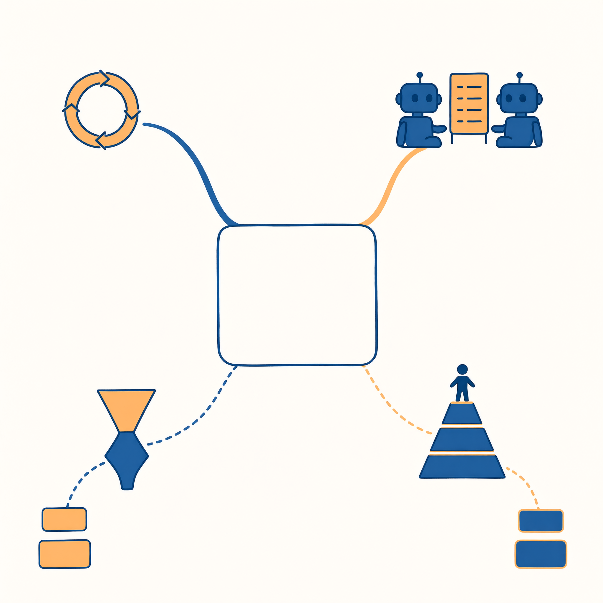

# 第 10 章　学会复盘：自我修正与质量控制

> 书稿状态：初稿 v0.2（扩写稿）｜目标字数：约 1.0 万｜体例：理论章模板

---

**现象索引**（本章能解释的动手现象）：
- 技能里为什么要写"自检点"？自检真有用吗？→ §10.1、§10.2
- 为什么 AI 自评容易"自我感觉良好"？→ §10.2
- 为什么自检点要写成"对照模板打钩"而不是"确认质量良好"？→ §10.2
- 第 6 章测试为什么要求"看过程"？→ §10.6
- "作者—编辑"打磨法（附录 C 创作配方）的原理？→ §10.3
- 为什么批评要对照清单，而不是"你再看看哪里能改"？→ §10.3
- 让多个 AI 互相挑错，比一个 AI 自查强在哪？→ §10.3–10.4
- 为什么"AI 给 AI 打分"便宜但不能全信？→ §10.6
- 为什么系统"结果全对"你还是不放心？→ §10.6

**学习目标**：能描述"行动—评估—反思—改进"循环并指出反思在安装位置上的讲究；能用"外部信号"标准评估一个自检设计；能搭一个评估-优化环并防过拟合；能区分结果评估、轨迹评估与线上指标三层。

---

第 9 章解决了"行动怎么组织"，本章解决下一个问题：**行动的结果怎么变好**。这是全书从"组装"迈向"运营"的一章——毕业项目交上去只是开始，系统要在一轮轮复盘中变可靠。老规矩：机制先行，每个机制配一个你撞过的现场。

## 10.1　复盘日记：Reflexion

让系统从失败中改进的最小机制，名字叫**反思（Reflexion）**：**行动 → 得到结果与反馈 → 让大脑写一段"反思" → 把反思记入简报包 → 再试一次。**

看一个完整的反思循环（报告被打回的场景）：

> **第一轮**：起草活动报销说明 → 提交 → 财务退回："缺发票号，事项与预算科目对不上。"
> **反思**（系统被要求写一段失败分析）："我假设财务只需要事由和金额。实际要求是：每笔支出附发票号、对应预算科目。我手头材料里没有发票号——应该在动笔前就向用户索要，而不是留空猜测。"
> **第二轮**：反思文本进了简报包 → 系统先列出缺件清单向用户索要发票号 → 补齐后重写 → 通过。

> 排版与标注说明见本章图表清单及《插画交付清单》§二（标注于排版时添加，定稿前移除本行）。

反思为什么有效？机制不难懂：**失败的原始形态对下一轮指导有限**——"被退回"三个字信息量趋近于零；把失败**翻译成教训**（哪里错了、为什么、下次怎么办），等于给下一次尝试递了一份针对性的简报（§8.3：递进去的材料决定表现——教训也是材料）。第 2 章的手册修订日志、第 4 章的自检点、第 6 章的翻车归因，全是反思机制的手工版：你已经在用，本章把它讲透。

好反思与坏反思，一眼可辨。**坏反思**："我应该更仔细。"（正确的废话——下一轮的大脑从这句话里得不到任何新信息。）**好反思**："我假设了 X，实际是 Y；下次遇到同类任务，先确认 X 还是 Y 再动笔。"三段式：**错在哪（具体到假设）→ 为什么错 → 下次的具体动作**。给你的系统写反思规矩时，就按这三段要求——"写反思"本身也需要模板（第 4 章四段式在此复用）。

反思还有第二个用途，常被忽略：**把成功经验也喂回去**。失败反思防止重蹈覆辙，成功反思则沉淀手艺——这次为什么顺？是哪条规矩、哪个模板、哪份材料起了作用？把答案写进技能或手册，就是 §11.2 说的"情节沉淀为程序"。只反思失败的团队会越跑越保守（处处设防），只反思成功的团队会越跑越飘（经验当定律）；两个方向都记，才叫复盘。

安装位置也有讲究：反思写在**简报包的累积层**（§8.3），只对当前任务链生效；如果教训是普适的（"财务类任务必须先要发票号"），要人工把它**升格**进手册或技能——反思是便签，手册是制度，便签不能自动变制度（谁审谁升级？你审。§11.2"沉淀可以自动，入库必须过人"的第一次现身）。

## 10.2　自我催眠的风险

但反思有个致命软肋：**自我评价不可靠**。§7.2 的概率本性在这里第二次收费——大脑评价自己的产出时，干的仍是"接最像的话"，而看完自己刚写的流畅文章后，"最像的话"是什么？"总体不错，个别地方可以更好。"

没有外部参照的反思，容易滑向**自我确认**：错的地方被解释成"合理的取舍"，漏掉的要求被解释成"超出范围"，第 2 章说的"自信地错"在复盘环节重演。工程上这个现象有个直白的名字：自我评估的分数与真实质量的**相关性低得令人尴尬**——它给自己打 90 分的产出，外部标准量出来可能 60 分，且它对此毫无察觉。

所以本章的核心论断只有一句：

> **反思要有外部信号，不然就是自我催眠。**

外部信号三种，按可靠性排序：

**表 10-1　三种外部信号对照**

| 信号 | 例子 | 可靠性 | 成本 |
|---|---|---|---|
| 人工判断 | 你对照原件验收、导师退稿、财务打回 | 最高（承担后果的人在场） | 最贵 |
| 环境反馈 | 测试跑没跑通、邮件发没发出、检索查没查到、格式校验过没过 | 高（不会说谎，但只管得了可机检的事） | 便宜 |
| 另一个 AI 评审 | 编辑角色对照清单批评 | 中（同病相怜，见 §10.6） | 最便宜 |

设计任何"让 AI 自我改进"的流程，先问一句：**它的反思对照的是什么信号**？对着空气反思的流程，跑得再热闹也只是仪式。三种信号的正确搭配是金字塔：**环境反馈兜底**（能机检的全部机检——格式、出处存在性、数字对账），**AI 评审粗筛**（对照清单挑明显问题），**人工终评**（不可逆的、价值性的、拿不准的）。这条金字塔与安全带第三条是同一座建筑：核验清单是人工终评的随身版，停止条件是环境反馈的自动化版——你在第 1 章系上的安全带，到这里长成了完整的评估制度。

这也回收了第 4 章自检点的设计原则：自检要写成**可核对的动作**（"对照模板逐节打钩""每个行动项有负责人和期限吗"），不能写成"确认质量良好"——前者强迫它把产出与**模板这个外部标准**逐项比对（比对是它擅长的），后者让它评价自己（评价是它不可靠的）。**自检点的本质，是把外部信号"走私"进自我检查的流程里**——模板、清单、格式规范，都是安插在自查环节里的"卧底评委"。

◆ **概念桥**｜**闭门练演讲**。人人都有过体验：自己排练时感觉良好，上台才发现问题——因为排练时的"自我评价"没有听众这个外部信号。写作界的老规矩同理：稿子要"放一夜再看"（时间当外部信号——隔夜的你比当下的你陌生）、要读出声（耳朵当外部信号）、要给同行看（读者当外部信号）。AI 的反思机制没有超出这条常识，只是把常识写成了流程：**给自查安插卧底，给自评配上对照物。**

## 10.3　作者与编辑：Evaluator-Optimizer

把 §10.2 制度化，就是**评估-优化模式**（Evaluator-Optimizer）：一个角色**生成**（作者），另一个角色**评估**（编辑：对照标准给出具体批评），生成方依据批评重写——循环到编辑满意或轮次用尽。

一个三轮打磨的完整走查（社团推文场景，逐轮全文摘录）：

> **初稿（作者，开头摘录）**："读书节来啦！今年的活动精彩纷呈，内容丰富，欢迎大家踊跃参与，不要错过！"
> **第一轮批评（编辑，对照清单逐项）**：清单 1 不过——标题与开头无钩子，只有感叹号；清单 2 不过——"精彩纷呈""内容丰富"两处形容词零事实支撑；清单 3 不过——无时间地点；清单 4 过（字数达标）；清单 5 不过——"内容丰富"疑似空话，素材库中查无对应事实。
> **二稿（摘录）**："4 月 12 日 14:00，图书馆广场：旧书漂流、作者共读、深夜书摊三场同开。去年活动 3 天报满 200 人——今年扩容到 300，报名已开。"
> **第二轮批评**：清单 1 过（数字＋事件开头）；清单 2 过（三个形容词换成了三个名词，"3 天报满 200 人"已对照去年复盘文件核实）；清单 3 待改——"报名已开"没有入口方式；清单 5 提示（注意，不是"不过"）——"3 天报满"出处已核，保留。
> **三稿**：补报名入口与截止时间 → 清单全过 → 交付（人过目后发布）。

> 排版与标注说明见本章图表清单及《插画交付清单》§二（标注于排版时添加，定稿前移除本行）。

两个观察值得记录。其一，编辑的批评**句句引用"清单第 N 条"**，从不说"我感觉"——清单把审美变成了可核对的条款，这是这个环与"你再看一眼"的本质区别；其二，注意第二轮里"提示"类的存在：编辑不只挑错，还要**放行已核实的事实**（防止作者改稿时把对的东西也改没了）——只挑错不放行的编辑，会在第三轮被作者绕过，人类编辑部如此，AI 编辑部也如此（评估者的标准本身也需要评估，§10.6 的递归在小处的显形）。

注意编辑的批评全程**具体、可执行、对照清单**——"更有感染力一点"这种批评会让循环空转（作者无从下手，只能换几个形容词再交）。所以这个模式的成败不在"编辑"这个角色，在**批评清单的质量**。清单范例（五条，条条可判断）：

**表 10-2　编辑批评清单范例**

> **编辑批评清单（推文）**
> 1. 标题前八个字里有钩子（提问/数字/冲突）吗？
> 2. 每个形容词背后有事实或数字支撑吗？逐处圈出没有的。
> 3. 时间、地点、报名方式三要素齐吗？与素材库原文一致吗？
> 4. 字数在各平台上限内吗？
> 5. 有没有素材库之外的"事实"？有则标红（幻觉嫌疑）。

两个角色可以是两个助理（第 5 章"作者-编辑对"配方：各自独立手册，互不通气），也可以是同一个助理的两轮（第一轮写作，第二轮换上编辑手册批评自己）。哪种好？各有取舍：**两个助理**隔离干净（编辑没参与写作，不护短），但传话有损（§13.2）；**同一助理两轮**省成本，但"自己批自己"的独立性弱——它记得自己为什么那么写，容易手下留情。经验法则：**清单越硬，同一助理越够用；清单越软（审美类判断），越值得上双助理。**

两个代价，用前须知。**成本翻倍**：每轮至少两次调用，三轮打磨就是六倍账单——所以此模式只配给高价值产出（要发布的、要署名的、要提交的），日常草稿别用。**编辑决定天花板**：编辑偏爱的不是"好"，是"编辑认为的好"；作者会学会讨好编辑而非讨好读者——这个毛病叫**过拟合评估偏好**，人类世界的全名你可能更熟：应试作文。处方两条：编辑的标准必须来自外部（读者要求、平台规范、你的风格指南——清单第 3 条"与素材库原文一致"就是外部锚）；定期换清单（评审标准也要迭代，否则作者摸清套路后，循环又开始空转）。

还有一个隐藏收益，比改进本身更值钱：**清单是协作接口**。当生成方与评估方（两个 AI 也罢，AI 与你也罢）共用同一份清单，"返工"就从态度问题（"你认真一点"）变成工程问题（"第 3 条没过，缺报名入口"）——冲突变成信息，情绪变成工单。这就是成熟团队先写验收标准再写需求的原因：**清单不是协作的事后裁判，是协作的事前合同**。你与 AI 的协作、日后你与人的协作，同一份合同格式都适用。

## 10.4　编剧与剧评人：Actor-Critic 及变体

评估-优化的近亲家族，按"**批评者手里有什么**"区分：

**Actor-Critic（行动-批评）**：批评者的权威来自它握着的外部信号。写代码的场景，剧评人手里有**测试结果**——"第三、七个用例没过，报错如下"，这种批评无法反驳；写作的场景，剧评人手里有**你的风格指南**——"违反第 2 条：形容词无支撑，共三处"。对照 §10.2 的金字塔：Actor-Critic 就是把"环境反馈"或"人工标准"正式安装进批评角色。

**生成-判别（Generator-Discriminator）**：一个量产内容、一个验真伪，用于**批量筛选**——合成一百条问答对，判别者按标准挑出可用的十条；生成一千个标题，判别者按点击预测排序。与评估-优化的区别：不改，只挑（没有"依据批评重写"环节，淘汰即可）。软肋更尖锐：**判别者弱，生成者就会骗过它**——被判别的模型摸清判别标准后，专产"判别者给高分但真实质量差"的内容，两者进入军备竞赛。所以判别标准要定期人工校准（抽一批判别结果自己复核），且判别者最好与生成者**不同源**（不同模型，或至少不同手册——同质自判是 §10.2 自我催眠的批发版）。

一句话记住整个家族：**挑错的角色，必须比犯错的角色多知道点什么**——多一份标准、多一个测试结果、多一双眼睛。否则挑错只是表演，而表演也是要付 token 的。

表演还会进化成军备竞赛，看一个真实形态的案例：**标题农场的过拟合**。某内容团队用"生成-判别"环批量产标题，判别器偏好带数字的标题（数据上数字标题点击率高）。二十轮之后，生成器学会了一件事：往标题里塞数字——"让你惊讶的 7 个原因""3 分钟看懂 5 个误区"，数字与内容是否相关不再重要。判别器满意，点击率起初上升，随后读者学会跳过这类标题，真实质量下滑——而环内指标一片向好。病灶不在生成器狡猾，在**判别器的标准单一且可被表面特征满足**（§10.3 过拟合评估偏好的批发版）。处方也在那里：标准多维化（数字只是其一）、定期人工校准（抽真点击数据复核判别器）、以及永远保留一条环外信号——读者的退订率。

## 10.5　头脑风暴：多路探索

另一类改进不靠批评，靠**选项**。思维树（Tree of Thoughts）的思想一句话：在关键决策点，别急着选第一条路——让大脑生成多个候选方向，各自往下推演几步，评估打分，剪掉差的，留好的继续。

完整走查（读书节主题决策）：

> **发散**：一次生成五个主题候选（不许多想，先凑数）：旧书漂流／作者共读／深夜书房／一本书的旅行／校园诗歌夜市。
> **推演**：每个候选往下想两步——要什么资源？可能的翻车点？（漂流：书源征集难；诗歌夜市：场地审批复杂……）
> **评估**：对照三条标准打分（成本≤500 元／两周可筹备／预期到场≥80 人）。
> **剪枝**：留前二，其余归档（不是删除——归档的候选是下次活动的种子）。
> **深入**：对留下的两个各出一页方案，人选一。

直觉原型是头脑风暴的完整规则：**先发散（不许批评）、后收敛（对照标准筛）**——大多数人和大多数 AI 的日常毛病都是发散到一半就收敛了（第一个像样的念头出现，搜索就停止了）。多路探索用结构强制"多想几个再挑"。

代价：贵——每个分支都是真金白银的调用，五个候选各推演两步就是十几次生成。所以实践形态通常是**收敛版**：重要决策点生成 3–5 个候选、快速比较、选一个深入——附录 C 创作配方的"标题打磨"（一次 5–8 个风格各异的候选→对照标准筛→深挖前二）就是这个形态。判断值不值得多路的三问：**决策重要吗（错了贵）？选项空间大吗（一条道的活不必发散）？标准明确吗（没有标准，发散完还是拍脑袋）**？三问两"是"以上才用。

三问里"错了贵"值得再拆一层：**贵的是哪种错**？有些选择错了之后，后续选项全部关闭（定选题、定结构、定文章基调）——返工代价是**结构级**的，推倒重来；有些选择错了随时可改（标题措辞、段落顺序、配色）——返工代价是**表面级**的，改了就是。**多路探索只值得花在结构级选择上**；拿它做表面级选择，是花钱买安心——安心有用，但账单要记在"情绪价值"科目下，别记在"质量"科目下。判断口诀一句：问自己"这个选择错了，是重写还是修改？"重写→结构级，上多路；修改→表面级，单路走完再调。

## 10.6　评分标准：怎么知道 Agent 干得好不好

最后把镜头从"改进"拉到"评估"——没有评估，改进无从谈起（改好了没有？拿什么说？）。三个层次，一层比一层硬：

**第一层：看结果，也看过程**。结果评估问"答案对吗"；**轨迹评估**问"路走对了吗"。同一任务的两条轨迹：

**表 10-3　双轨迹对照**

> 轨迹甲：检索一次 → 命中权威来源 → 交叉验证 → 作答带引用。（干净）
> 轨迹乙：检索五次（三次重复关键词）→ 命中一个论坛帖 → 未验证 → 作答，碰巧对了。（侥幸）

结果评估给两者同样的"对"；轨迹评估看见乙的三个病灶：绕路（成本与延迟）、信源弱（下次未必碰巧）、跳过了验证步骤（核验制度形同虚设）。第 6 章"结果全对但过程绕远"思考题的答案在此：**过程里的绕路与侥幸，是下一次失败的存款**——只看结果的系统，会在存款到账那天突然崩掉，且崩得无从排查（日志里全是"对"）。轨迹评估的检查项就四问：工具选对了吗？有没有多余动作？跳步了吗？动过不该动的东西吗？（最后一问直通第 14 章。）

**第二层：用 AI 评 AI（LLM-as-Judge）**。让一个（通常更强的）模型按评分细则给产出打分。优点：快、便宜、可规模化——毕业项目的十例测试若全人工评，你会崩溃。四个偏差要背下来：**偏爱长答案**（长的显得用心——细则里加"简洁性"项并对字数设限）；**偏爱顺耳答案**（与评审模型自身立场一致的得高分——细则写行为标准，不写价值倾向）；**位置偏差**（先出现的候选占便宜——两两对比时交换顺序各评一次）；**自我偏好**（评审对自己风格的产出天然手松——同源模型互评时最甚，跨源评审可缓解）。四个偏差有一个共同根源：评审也是概率大脑，它的"评分"同样是接话——接得最像"一个认真的评审会说的话"。所以 AI 评审的正确用法：**粗筛用它，终评用人**；细则越具体，它越可靠（又一次：可判断的标准是一切评估制度的地基）。它就是学术界的匿名同行评审——有用，但永远要问：审稿人内行吗？有利益冲突吗？

**第三层：线上真实指标最硬**。产品环境里，最终的评分标准不是任何模型的打分，而是三个数字：**任务完成率**（办成了吗）、**返工率**（用户推翻重来几次——返工率高说明"看起来对"与"真的能用"之间有缝）、**人工接管率**（多少次要人接手——接管率是系统自主性的诚实计量表，营销话术在这里全部失效）。

转述参考资料的金句作本章收束，它值得抄在开发日志第一页：

> **真正有用的问题不是"模型聪不聪明"，而是"任务完成没有、用户返工没有、系统失控没有"。**

顺带把本章最值钱的一份文档——评估细则——的写法立个标准，五条特征：**可判断**（每条对应可观察特征，形容词清零，§2.2 的规矩在评估层复利）；**有权重**（致命项一票否决——编造来源、越权发送；轻量项扣分——字数超限）；**带反例**（细则附一个"典型违反样本"：规则的边界住在反例里，只写正样本的细则会被钻空子）；**有出口**（写明"细则本身被质疑时怎么办"——提交人工仲裁，而不是评审者自由裁量；没有出口的细则会把争议变成死循环）；**有版本**（细则迭代留日志：你评估的是产出，校准的是尺子，尺子的改动也要可追溯——§10.3"定期换清单"的工程版）。五条齐备的细则，才是能把"批评"变成"信息"的那种清单。

◆ **原理速览**｜为什么评估体系必须三层齐备？因为三层各管一种自欺：只看结果，侥幸过关（轨迹层拆穿）；只做 AI 评审，同质互捧（线上层拆穿）；只看线上指标，知道坏了不知道哪坏（轨迹层定位）。三层互为依据，改进才有方向——这正是 §10.2"外部信号"论在系统层的展开。各层的工程实现细节见第 8 章 §8.3（记录层）与第 14 章 §14.4（审计层）。

◆ **比喻的边界**｜"编辑""剧评人"的比喻有一处失真：人类编辑有独立的审美与职业声誉，批评是**有立场的负责**；AI"编辑"没有立场也没有声誉，它的批评质量完全取决于你给的清单——清单之外的盲区，它和作者一样盲。所以 AI 评估环的天花板不在环内，在写清单的人：你（以及你请来做人工终评的人）。

---

**本章小结**：反思机制（失败→教训三段式→记入简报包→再试）有效但会自我催眠——**外部信号是生命线**（人工＞环境＞AI 评审，金字塔搭配）；自检点的本质是给自查安插卧底评委；评估-优化与 Actor-Critic 的要害都是"批评者手里有外部标准"，代价是成本与过拟合偏好；多路探索先发散后收敛，三问定值不值；评估三层（结果/轨迹/线上指标）各拆一种自欺——金句收束：任务完成没有、用户返工没有、系统失控没有。

> 标注说明：中心词与分支标签按本章小结填写，排版时添加（底稿无字）。

**思考题**

1. （复述）写出好反思的三段式；给三种外部信号按可靠性排序并各举一例；解释"自检点是把外部信号安插进自查流程"。
2. （辨析）两个改进方案：甲——让助理每次回答后自评打分，低于 8 分重写；乙——让助理对照你的风格指南清单逐项检查，缺项重写。哪个更可能有效？用 §10.2 与 §10.4 的原理论证，并指出甲方案经过什么修改后可以保留。
3. （开放）"过拟合评估偏好"在人类世界的近亲是应试作文。结合你的经验讨论：给 AI 定评分细则时，怎么防止它学会"写得像好答案"而不是"写得好"？你的答案对人类教育有启发吗？

**回到动手**：给毕业项目加一轮"编辑环"：写一份 5 条的批评清单（每条可判断、至少两条锚定外部材料），让助理对照清单批评自己最近一次产出并按批评修订；对比前后，记录**哪条清单最锋利**（抓出问题最多）与**哪条形同虚设**（考虑改写或删除）——清单也要迭代。

**延伸阅读**

- 约翰·杜威《我们如何思维》："反思性思维"概念的出处——教育哲学百年前就把"从经验中学习"的条件讲透了：持续、开放、负责。§10.1–10.2 是它的机器版。
- 回读本书第 4 章 §4.2 自检点、第 6 章 §6.4 测试方法论：两处实操的理论地基全在本章；反过来，本章每个机制在第 4、6 章都有可直接复用的模板。

---

## 附：本章图表清单（供编辑与插画师）

| 编号 | 名称 | 位置 | 形式 |
|---|---|---|---|
| 图 10-1 | 反思循环图（带外部信号） | §10.1 | 循环图＋三种信号输入箭头 |
| 图 10-2 | 作者-编辑环 | §10.3 | 双角色循环图，清单居中 |
| 图 10-3 | 本章地图 | 小结 | 思维导图 |
| 表 10-1 | 三种外部信号对照 | §10.2 | 三行四列 |
| 表 10-2 | 编辑批评清单范例 | §10.3 | 五条清单（可复印） |
| 表 10-3 | 双轨迹对照 | §10.6 | 甲乙两列四检查项 |
